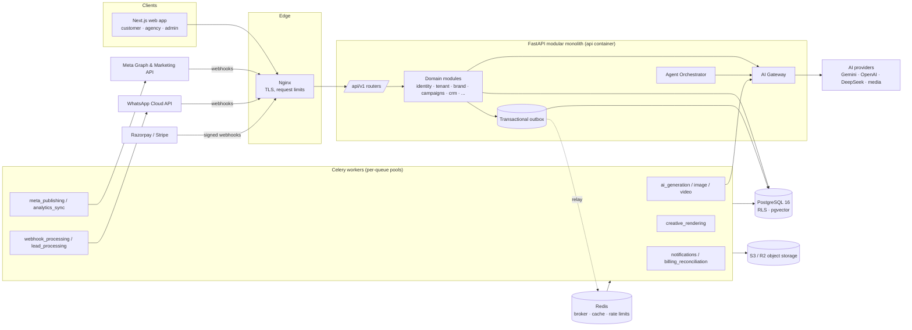
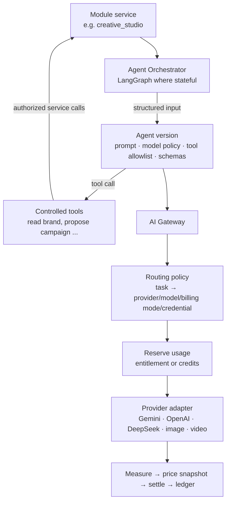
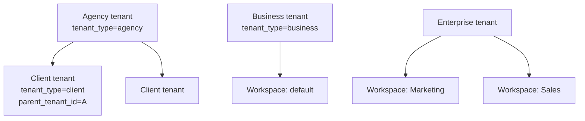
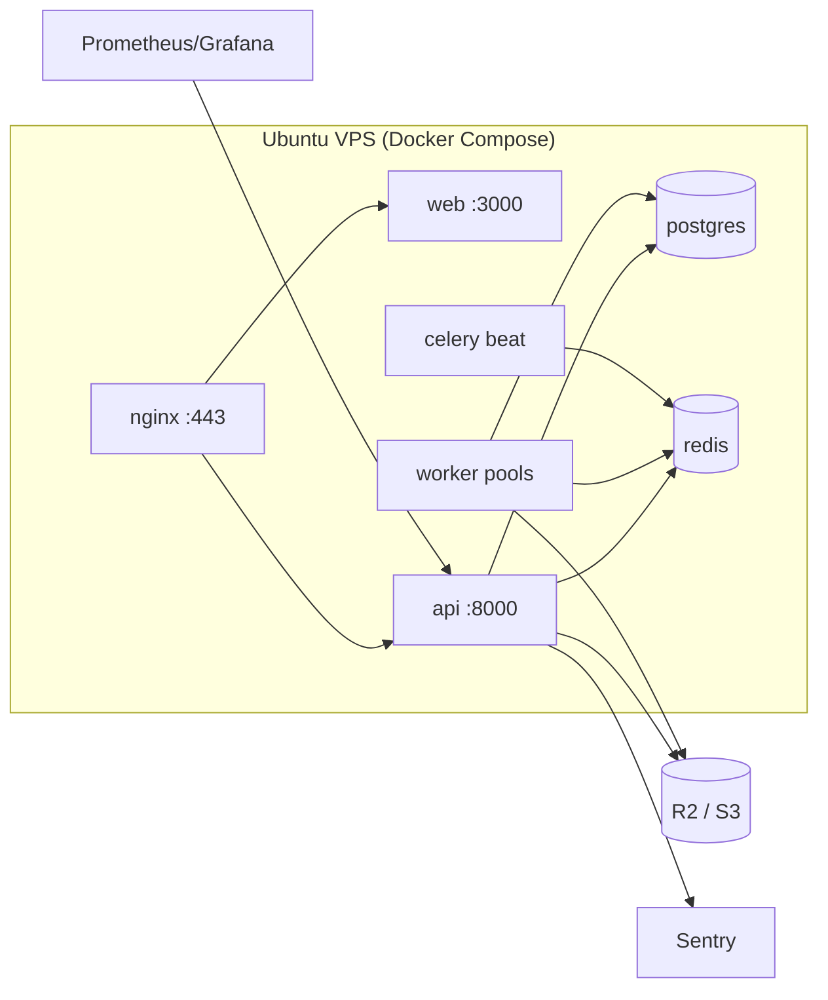

# XploAds — Technical Architecture

| | |
|---|---|
| Product | XploAds (owned by Xplosys) |
| Status | Architecture baseline v1.0, Phase 1 implemented |
| Topology | Modular monolith + asynchronous workers |
| Related | [Roadmap](ROADMAP.md) · [Database design](../database/SCHEMA.md) · [Repository structure](REPOSITORY_STRUCTURE.md) · [Risks & decisions](RISKS_AND_DECISIONS.md) · [Security](../security/SECURITY.md) |

This document is the engineering baseline for XploAds. It is derived from the product master prompt and
the HLD/LLD blueprint (`XploAds_HLD_LLD_Architecture.pdf`). Where the two differ, the master prompt wins.

---

## 1. Requirements analysis (summary)

XploAds automates the Meta (Facebook / Instagram / WhatsApp) advertising lifecycle for three customer types:

| Customer | What changes architecturally |
|---|---|
| Individual business | One organization (tenant), a few users, one or more brands. |
| Agency | One agency tenant that owns many **client tenants**. Client data (brands, Meta connections, leads) must never mix. Agency staff act inside client tenants through explicit, auditable access. |
| Enterprise | One tenant with many **workspaces** (departments), custom roles, budgets, usage limits and audit history. |

Non-negotiable constraints that shape the design:

1. **Tenant isolation** is enforced in the database (PostgreSQL RLS), not only in application code.
2. **Customer control over money.** Publishing, budget changes and other spend-affecting actions require explicit approval or a narrowly scoped, customer-approved policy. AI agents can only *propose*.
3. **Financial integrity.** Money is `NUMERIC`, the ledger is immutable double-entry, every billable call is idempotent, usage is reserved before and settled after expensive work.
4. **Provider independence.** Every AI call goes through one AI Gateway; BYOK is never silently switched to platform-paid credentials.
5. **Long work is asynchronous.** Image/video generation, publishing, webhooks, analytics never run inside an HTTP request.
6. **Honesty about integrations.** Mock modes are explicit and labelled; nothing is presented as production-ready until verified in an authorized test environment.

---

## 2. System architecture



### 2.1 Runtime components

| Component | Technology | Responsibility |
|---|---|---|
| Web | Next.js (App Router), TypeScript, Tailwind, shadcn/ui, TanStack Query, RHF + Zod | Public site, customer app, agency app, super-admin portal. Holds no secrets. |
| API | Python 3.12, FastAPI, Pydantic v2, SQLAlchemy 2.x (async), Alembic | All synchronous business APIs under `/api/v1`. |
| Workers | Celery 5 on Redis, one pool per workload class | Long-running and retryable work. Video workers isolated from light workers. |
| Database | PostgreSQL 16 (+ pgvector when retrieval is needed) | Source of truth, RLS, ledger. |
| Cache / broker | Redis 7 | Celery broker, cache, rate-limit counters, distributed locks. **Never** a financial source of truth. |
| Object storage | S3-compatible (MinIO locally, Cloudflare R2 / S3 in production) | Brand assets and generated media under `tenants/{tenant_id}/...` prefixes; short-lived signed URLs. |
| Edge | Nginx | TLS termination, body-size limits, upstream routing, static caching. |
| Observability | structlog JSON logs, Sentry, Prometheus + Grafana | Request IDs everywhere, per-queue metrics, error tracking. |

### 2.2 Why a modular monolith

One deployable API keeps transactions, RLS context and the outbox simple while the product is young. Each module
owns its tables and exposes a Python service interface plus domain events, so a module (most likely media workers,
webhook ingestion or analytics) can be extracted into a service when metrics justify it — without rewriting callers.

---

## 3. Module architecture

| # | Module (`backend/app/modules/…`) | Owns (tables) | Key dependencies |
|---|---|---|---|
| 1 | `identity` | users, sessions, auth tokens, MFA | — |
| 2 | `tenant` | tenants, workspaces, tenant_users, roles, permissions, role_permissions, user_roles, invitations | identity |
| 3 | `subscription` | plans, plan_entitlements, subscriptions, wallets, ledger_*, invoices, payments, billing_adjustments | tenant |
| 4 | `provider` | ai_providers, provider_models, provider_pricing, provider_credentials, tenant_provider_configs | tenant |
| 5 | `ai_gateway` | usage_events, usage_costs, usage_reservations | provider, subscription |
| 6 | `ai_agents` | agent_definitions, agent_versions, agent_runs | ai_gateway |
| 7 | `brand` | brand_profiles, brand_assets, brand_guidelines, products | tenant |
| 8 | `creative_studio` | creative_projects, generation_jobs, creatives, creative_versions | brand, templates, ai_agents, ai_gateway |
| 9 | `templates` | templates, template_versions | tenant |
| 10 | `campaigns` | campaigns, ad_sets, ads, campaign_schedules | creative_studio, audience, meta, approvals |
| 11 | `audience` | audiences | meta |
| 12 | `meta` | social_connections, meta_assets, oauth_grants, webhook_receipts (meta) | tenant |
| 13 | `whatsapp` | whatsapp_accounts, conversations, messages, opt_ins | meta, crm |
| 14 | `crm` | leads, contacts, lead_sources, lead_assignments, lead_activities, pipeline_stages | tenant |
| 15 | `automation` | workflows, workflow_versions, workflow_runs, workflow_steps | crm, whatsapp, notifications |
| 16 | `analytics` | metric_snapshots, conversion_events, report_jobs | campaigns, crm, ai_gateway |
| 17 | `approvals` | approvals (+ shared audit_logs writer) | tenant |
| 18 | `administration` | feature_flags, platform settings (platform-scoped) | all (read-only projections) |

Cross-cutting platform code lives in `backend/app/core` (config, DB, security primitives, logging, errors, rate
limiting) and `backend/app/shared` (outbox, audit writer, pagination, notification adapter). `shared` must never hold
business rules.

### 3.1 Standard module layout

```
module_name/
├── api/            # FastAPI routers + dependency wiring only
├── schemas/        # Pydantic request/response DTOs (never ORM objects in responses)
├── models/         # SQLAlchemy models owned by this module
├── repositories/   # Tenant-scoped persistence
├── services/       # Use cases and business rules
├── integrations/   # Vendor adapters (only if the module owns the integration)
├── events/         # Versioned domain event contracts
├── permissions/    # Permission codes declared by this module
└── README.md       # Ownership, APIs, tables, events, dependencies
```

Tests live in `backend/tests/<module>/` (kept outside the package so the production image excludes them).
Migrations live in one Alembic tree (`backend/alembic/versions`) with one revision per module change, prefixed by
module name, so ordering across modules stays linear and reviewable.

### 3.2 Dependency rules

- Routers call services; services call their own repositories and *other modules' services*, never other modules'
  repositories or tables.
- Cross-module side effects travel as domain events through the outbox.
- Vendor SDKs only inside `integrations/` adapters, each with a `mock` implementation selected by configuration.
- No circular imports between modules (checked in CI by an import-linter contract — Phase 9).

---

## 4. Frontend architecture

```
frontend/
├── app/                  # App Router: (marketing), (auth), app/[tenant], agency/, admin/
├── components/ui/        # shadcn/ui primitives (design tokens in globals.css)
├── components/           # Shared composites (AppShell, OrgSwitcher, EmptyState …)
├── features/<module>/    # Feature folders mirroring backend modules: api hooks, forms, views
├── services/api-client.ts# Typed fetch wrapper, token refresh, error envelope parsing
├── hooks/  lib/  types/
```

- **Auth model:** short-lived access token held in memory; refresh token in an `HttpOnly; Secure; SameSite=Strict`
  cookie scoped to `/api/v1/auth`. A silent refresh on load restores the session. No tokens in `localStorage`.
- **Active tenant:** chosen from the user's memberships and sent as `X-Tenant-ID`; the API verifies membership on
  every request and never trusts it otherwise.
- **Data:** TanStack Query for server state; forms with React Hook Form + Zod schemas mirroring Pydantic DTOs.
- **Portals:** customer app (`/app`), agency app (`/agency`), super-admin (`/admin`, separate permission set and
  separate login guard). Every page has loading, empty, error and success states; no control without a working action.

---

## 5. Backend architecture

Request lifecycle:

```
Nginx → RequestID middleware → CORS → rate limiter (Redis)
  → auth dependency (JWT verify, session not revoked)
  → tenant dependency (X-Tenant-ID → membership check → permissions loaded)
  → DB session: BEGIN; SET LOCAL app.user_id, app.tenant_id
  → service → repository (queries run under RLS)
  → outbox rows written in the same transaction
  → COMMIT → error envelope / response DTO
```

- **Error envelope:** `{"error": {"code", "message", "request_id", "details"}}` for every failure.
- **Pagination:** `limit`/`offset` with `total`, plus `sort` on whitelisted fields.
- **Idempotency:** `Idempotency-Key` header required on billable and externally consequential endpoints (Phase 3+).
- **Outbox:** `outbox_events` rows are written inside the business transaction; a Celery beat task relays them with
  `FOR UPDATE SKIP LOCKED`, retries with exponential backoff and moves poison messages to `dead` status.

---

## 6. AI architecture



- **AI Gateway** is the only code allowed to call model providers. It resolves provider, model, credential owner and
  billing mode from `tenant_provider_configs`, estimates and reserves cost, calls the adapter, records
  `usage_events` + `usage_costs` with a pricing snapshot, and settles the reservation against the ledger.
- **BYOK rule:** fallback may only move between combinations the tenant explicitly authorized; a BYOK request never
  falls back to platform credentials.
- **Agents** are versioned records (instructions, model policy, tool permissions, input/output JSON schemas). Outputs
  are validated against schemas; invalid output is retried or failed, never passed on.
- **No agent touches the database, credentials, Meta or money directly.** Agents call allowlisted tools that delegate
  to services, which enforce permissions. Agents can *create proposals* (campaign drafts, budget suggestions) that a
  human approves.
- **Prompt-injection posture:** customer content, websites and uploads are untrusted data, delimited in prompts, never
  allowed to change tool permissions; secrets never enter prompts or agent run history.
- **Creative accuracy:** logos, prices, exact text and product photos are composited deterministically (Pillow /
  FFmpeg templates); generative models produce backgrounds, scenes and variations.

---

## 7. Multi-tenant architecture

### 7.1 Tenant model



- **Tenant = isolation and billing boundary.** Every tenant-owned row carries `tenant_id`.
- **Workspaces** are sub-divisions inside a tenant (departments, teams). Role assignments may be scoped to a workspace.
- **Agency clients are separate tenants** (`tenant_type='client'`, `parent_tenant_id` = agency). This gives each client
  hard RLS isolation, its own Meta connections and brands, and makes "hand the client over" a re-parenting operation.
  Agency staff reach a client tenant either through a direct membership or through an agency role holding
  `agency.clients.access`; both paths are checked by the API and audited.

### 7.2 Context propagation and RLS

1. JWT identifies the user. 2. `X-Tenant-ID` names the desired tenant. 3. The API verifies an active membership (or
agency access) and loads permissions. 4. Each transaction runs
`SELECT set_config('app.user_id', …, true), set_config('app.tenant_id', …, true)`. 5. RLS policies compare rows to
those settings. The application connects as **`xploads_app`**, a role that is not the table owner and has
`NOBYPASSRLS`; tables also use `FORCE ROW LEVEL SECURITY`. Migrations run as **`xploads_owner`**.

Jobs and events carry `tenant_id`; workers re-validate and set the same context before touching tenant data.
Cache keys are `t:{tenant_id}:…`; object keys are `tenants/{tenant_id}/…`.

---

## 8. Database architecture

Normalized PostgreSQL schema, UUID primary keys, `created_at`/`updated_at` on every table, soft deletion
(`deleted_at`) where users expect restore, `NUMERIC(20,6)` for money and usage, JSONB only for provider-specific
metadata. Full ER diagrams and the table-by-table ownership and isolation rules are in
[`docs/database/SCHEMA.md`](../database/SCHEMA.md).

---

## 9. Integration architecture

| Integration | Pattern | Notes |
|---|---|---|
| Meta Login / Graph / Marketing API | `meta` module adapter + `mock` adapter | OAuth with signed `state`; tokens envelope-encrypted; App Review, Business Verification, Advanced Access required for production. Publishing runs on `meta_publishing` queue with idempotent external-ID tracking. |
| Meta Lead Ads webhooks | `POST /integrations/meta/webhooks` → verify `X-Hub-Signature-256` → `webhook_receipts` (unique provider+event id) → `webhook_processing` queue | Ack fast; process async; lead retrieval with the page token. |
| WhatsApp Cloud API | `whatsapp` adapter | Separate from Marketing API. 24-hour customer-service window, approved templates, opt-in tracking. |
| AI providers | AI Gateway adapters | Gemini, OpenAI, DeepSeek; image/video providers behind the same interface. |
| Payments | `subscription` payment adapter (Razorpay, Stripe) | Subscription state changes **only** from verified webhooks, never from browser redirects. |
| Email | `shared.notifications` adapter (`console` in dev, SMTP/provider in prod) | Verification, reset, invitations. |
| Object storage | S3 API (boto3 in Phase 2) | Tenant prefixes, signed URLs, content-type and size validation, malware scanning hook. |

Every adapter has a `mock` mode chosen by environment (`META_MODE=mock|live`, etc.). The UI shows a visible
"Mock integration" badge while in mock mode.

---

## 10. Security architecture

Summarized here; details in [`docs/security/SECURITY.md`](../security/SECURITY.md).

- Argon2id password hashing; JWT access tokens (15 min) + rotating refresh tokens stored as SHA-256 hashes in
  `sessions`, with reuse detection that revokes the session family.
- TOTP MFA (RFC 6238) with login challenge tokens.
- Email verification and password reset tokens are single-use, hashed, short-lived; reset revokes all sessions.
- RBAC with permission codes; platform-admin privileges (`users.is_platform_admin`) are separate from tenant roles.
- RLS on every tenant-owned table; dedicated cross-tenant tests in CI.
- Redis rate limiting on auth endpoints; request size limits at Nginx and FastAPI.
- Secrets: integration credentials stored with envelope encryption (data key per secret, KEK from a KMS / env-provided
  key outside the DB). Secrets are redacted from logs by a structlog processor.
- Webhook signature verification and replay protection; OAuth state validation; SSRF guard for URL fetching.
- Append-only audit log (`UPDATE`/`DELETE` revoked from the app role).

---

## 11. Deployment architecture



- Environments: `local`, `staging`, `production`, each with its own `.env` and Compose override.
- Migrations: `alembic upgrade head` as `xploads_owner` in a one-off container before the API rolls.
- Backups: nightly `pg_dump` + WAL archiving (or managed Postgres PITR), object-storage versioning, restore drills.
- Details and VPS runbook: [`docs/deployment/DEPLOYMENT.md`](../deployment/DEPLOYMENT.md).
