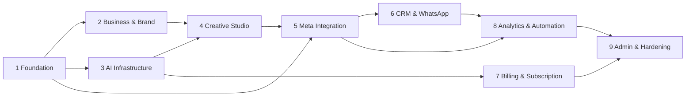

# XploAds — Implementation Roadmap

Phases follow the master prompt (section 14). Each phase ends with a milestone review: tests green (including all
earlier phases), docs and `docs/IMPLEMENTATION_STATUS.md` updated.

| Phase | Scope | Depends on | Milestone / exit criteria | External prerequisites |
|---|---|---|---|---|
| **1 Foundation** | Repo, Docker, Postgres + RLS roles, Redis, Celery + outbox, auth (register, login, refresh, logout, email verification, password reset, TOTP MFA), tenants, workspaces, memberships, invitations, RBAC, audit log, Next.js shell with auth + org management | — | Users can register, verify, log in (with MFA), create business/agency orgs and agency clients, invite members, assign roles. Cross-tenant tests pass. | None (console email) |
| **2 Business & Brand** | Organization settings, agency client workspace UX, brand profiles, brand guidelines, products/services, asset upload to object storage (tenant prefixes, signed URLs, type/size validation) | 1 | Brand kit complete per tenant; assets stored and served via signed URLs. | S3/R2 bucket |
| **3 AI Infrastructure** | Provider registry, models, versioned pricing, credentials (envelope encryption), tenant provider configs, AI Gateway with reservation → execution → settlement, usage events/costs, wallet + double-entry ledger skeleton, budgets and concurrency limits | 1 | A metered text call through the gateway produces a usage event, cost record and balanced ledger transaction; BYOK never falls back to platform. | Gemini / OpenAI / DeepSeek test keys |
| **4 AI Creative Studio** | Agent framework (versions, schemas, tool allowlists), business analysis / strategy / copy / creative-planning agents, image + video generation workers, Pillow/FFmpeg deterministic compositing, templates, creative library and versions, approvals for creatives | 2, 3 | A brief produces approved-ready copy, image, carousel and short video variants asynchronously, with usage reconciled. | Image & video provider accounts; FFmpeg in worker image |
| **5 Meta Integration** | Meta OAuth, asset discovery (pages, IG accounts, ad accounts), campaign/ad set/ad builder, validation, final review, approval-gated publishing, pause/resume, Lead Ads webhooks, insights sync | 1, 4 | Campaign published to a Meta **test/sandbox ad account** after explicit approval; leads arrive via verified webhook. | Meta app, App Review, Business Verification, Advanced Access |
| **6 CRM & WhatsApp** | Leads, contacts, dedupe, scoring, AI qualification, pipeline stages, assignment, activities, WhatsApp Cloud API (webhooks, conversations, templates, opt-in/out), follow-ups | 5 | Meta and WhatsApp leads land deduplicated in the CRM with attribution; compliant messaging. | WhatsApp Business account, approved templates |
| **7 Billing & Subscription** | Plans, entitlements, subscriptions, trials, credit purchases, invoices, Razorpay/Stripe adapters with verified webhooks, reconciliation, billing dashboards | 3 | Paid plan activation via webhook only; credit purchase flows to ledger; invoices numbered and reconcilable. | Merchant accounts, tax advice |
| **8 Analytics & Automation** | Campaign/business/AI-usage/agency dashboards, workflow engine (triggers, schedules, steps, run logs), optimization recommendations (proposal-only) | 5, 6 | Dashboards from synced insights with attribution caveats; workflows run with logs; recommendations require approval. | — |
| **9 Admin & Hardening** | Super-admin portal, feature flags, job/error monitoring, Prometheus/Grafana, load tests, security tests, backup/restore drills, production deploy runbook | all | Production readiness review passed. | Domain, TLS, VPS, Sentry |

## Phase 1 milestones (delivered 2026-11-22)

1. **M1.1 Docs & scaffolding** — architecture, roadmap, schema, risks; repo layout; Docker Compose; env examples.
2. **M1.2 Database foundation** — owner/app roles, Alembic baseline, identity + tenancy tables, RLS policies, seeds for permissions and system roles.
3. **M1.3 Identity** — register, verify email, login, MFA, refresh rotation, logout, password reset, sessions list/revoke.
4. **M1.4 Tenancy & RBAC** — organizations, agency clients, workspaces, members, invitations, roles, audit log.
5. **M1.5 Async foundation** — Celery app, queues, transactional outbox relay, email notification task.
6. **M1.6 Frontend shell** — Next.js app with auth pages, org switcher, organizations, members & invitations, security settings.
7. **M1.7 Verification** — pytest suite incl. cross-tenant isolation against real PostgreSQL; frontend type-check, lint and build.

## Phase 2 milestones (delivered 2026-11-23)

1. **M2.1 Schema** — migration `0002_business_brand`: organization profile fields, brand profiles, guidelines,
   products/services, brand assets; RLS; composite tenant foreign keys.
2. **M2.2 Object storage** — provider-neutral S3 adapter (R2, S3, SeaweedFS, MinIO) and a local backend; signed
   upload policies and download URLs; SeaweedFS in Docker Compose.
3. **M2.3 Brand API** — brands (default, archive, delete), guidelines, products & services, asset upload with
   server-side verification, metadata and rights, signed downloads, stale-upload cleanup job.
4. **M2.4 Frontend** — brand list, profile editor (voice, audience, value propositions, colours, fonts, socials,
   logo), guidelines, products & services, asset library with drag-and-drop upload; organization profile settings;
   "back to agency" navigation in client organizations.
5. **M2.5 Verification** — API, permission, isolation and storage tests; Playwright brand-kit flow on the full stack.

Carried forward: workspace-scoped permissions (assignments are stored; enforcement moves to Phase 4/5 when
creatives and campaigns can belong to a workspace), malware scanning (D12).
