# XploAds — Database Design

PostgreSQL 16. All conventions below apply to every table unless stated.

## 1. Conventions

| Rule | Detail |
|---|---|
| Keys | `id UUID PRIMARY KEY` (generated by the application, `uuid4`). |
| Timestamps | `created_at`, `updated_at` `TIMESTAMPTZ NOT NULL DEFAULT now()`; UTC only. |
| Soft delete | `deleted_at TIMESTAMPTZ NULL` on user-facing entities (users, tenants, workspaces, brands, campaigns, leads …). |
| Tenant scope | `tenant_id UUID NOT NULL REFERENCES tenants(id)` on every tenant-owned table + an index starting with `tenant_id`. |
| Tenant-safe FKs | Child tables reference parents with **composite FKs `(parent_id, tenant_id)`** to a `UNIQUE (id, tenant_id)` on the parent, so a row can never point at another tenant's record. |
| RLS | `ENABLE` + `FORCE ROW LEVEL SECURITY` on all tenant-owned tables. Policy compares `tenant_id` to `current_setting('app.tenant_id', true)::uuid`. |
| Money | `NUMERIC(20,6)` + `currency CHAR(3)`. Never float. |
| JSONB | Only for provider-specific metadata, snapshots and validation reports — never for relational links. |
| Enums | `TEXT` + `CHECK` constraints (easier to evolve than PG enums). |
| Ownership | Each table is owned by exactly one module; only that module's repositories write to it. |

### 1.1 Database roles

| Role | Attributes | Used by |
|---|---|---|
| `xploads_owner` | Owns schema and tables. `NOSUPERUSER`. | Alembic migrations only. |
| `xploads_app` | `NOSUPERUSER NOBYPASSRLS`, not owner; DML grants only; no `UPDATE/DELETE` on `audit_logs`; read-only on catalog tables. | API and workers. |

### 1.2 RLS session variables

| Setting | Set by | Meaning |
|---|---|---|
| `app.user_id` | Auth dependency (transaction-local) | Authenticated user. Lets a user see *their own* memberships across tenants. |
| `app.tenant_id` | Tenant dependency / worker (transaction-local) | Active tenant, derived from verified membership. |

Without these settings, tenant-owned tables return **zero rows** (the `true` flag makes `current_setting` return NULL
rather than raise, and `NULL = x` is never true).

---

## 2. Phase 1 schema (implemented)

```mermaid
erDiagram
  users ||--o{ sessions : has
  users ||--o{ auth_tokens : has
  users ||--o{ mfa_recovery_codes : has
  users ||--o{ tenant_users : "member of"
  tenants ||--o{ tenants : "parent of (agency → client)"
  tenants ||--o{ workspaces : contains
  tenants ||--o{ tenant_users : has
  tenants ||--o{ roles : "custom roles"
  roles ||--o{ role_permissions : grants
  permissions ||--o{ role_permissions : in
  tenant_users ||--o{ user_roles : holds
  roles ||--o{ user_roles : assigned
  workspaces ||--o{ user_roles : "optional scope"
  tenants ||--o{ invitations : issues
  roles ||--o{ invitations : "role offered"
  tenants ||--o{ audit_logs : records
  tenants ||--o{ outbox_events : emits

  users { uuid id PK; text email UK; text password_hash; text full_name; text status; timestamptz email_verified_at; bool mfa_enabled; bytea mfa_secret_encrypted; bool is_platform_admin; int failed_login_count; timestamptz locked_until }
  sessions { uuid id PK; uuid user_id FK; text refresh_token_hash UK; text previous_token_hash; timestamptz expires_at; timestamptz revoked_at; text revoked_reason }
  auth_tokens { uuid id PK; uuid user_id FK; text purpose; text token_hash UK; timestamptz expires_at; timestamptz consumed_at }
  mfa_recovery_codes { uuid id PK; uuid user_id FK; text code_hash; timestamptz used_at }
  tenants { uuid id PK; text name; text slug UK; text tenant_type; uuid parent_tenant_id FK; text status; text timezone; char country_code; char default_currency }
  workspaces { uuid id PK; uuid tenant_id FK; text name; text slug; bool is_default; text status }
  permissions { uuid id PK; text code UK; text module; text scope; text description }
  roles { uuid id PK; uuid tenant_id FK "NULL = system"; text key; text name; bool is_system }
  role_permissions { uuid role_id PK; uuid permission_id PK; uuid tenant_id }
  tenant_users { uuid id PK; uuid tenant_id FK; uuid user_id FK; text status }
  user_roles { uuid id PK; uuid tenant_id FK; uuid membership_id FK; uuid user_id; uuid role_id FK; uuid workspace_id FK }
  invitations { uuid id PK; uuid tenant_id FK; text email; uuid role_id FK; uuid workspace_id FK; text token_hash UK; text status; timestamptz expires_at }
  audit_logs { uuid id PK; uuid tenant_id; uuid actor_user_id; text action; text resource_type; text resource_id; jsonb metadata; timestamptz occurred_at }
  outbox_events { uuid id PK; uuid tenant_id; text event_type; jsonb payload; text status; int attempts; timestamptz available_at }
```

### 2.1 Table catalogue (Phase 1)

| Table | Owner module | Tenant isolation | Key constraints & indexes |
|---|---|---|---|
| `users` | identity | Global (not tenant-owned). Reached only through identity repositories; never listed across tenants. | `UNIQUE(email)` (stored lower-cased); `CHECK status IN ('active','disabled')`. |
| `sessions` | identity | Global, keyed by user. | `UNIQUE(refresh_token_hash)`; idx `(user_id)`. Rotating refresh token; previous hash kept for reuse detection. |
| `auth_tokens` | identity | Global, keyed by user. | `UNIQUE(token_hash)`; `CHECK purpose IN ('email_verification','password_reset','mfa_challenge')`; idx `(user_id, purpose)`. Single-use, hashed. |
| `mfa_recovery_codes` | identity | Global, keyed by user. | idx `(user_id)`; hashed, single-use. |
| `tenants` | tenant | **RLS:** visible if `id = app.tenant_id`, or the user has an active membership in it or in its parent. Insert/update only when `id = app.tenant_id`. | `UNIQUE(slug)`; `CHECK tenant_type IN ('business','agency','client','enterprise')`; `CHECK (tenant_type='client') = (parent_tenant_id IS NOT NULL)`; idx `(parent_tenant_id)`. |
| `workspaces` | tenant | **RLS** `tenant_id = app.tenant_id`. | `UNIQUE(id, tenant_id)`; `UNIQUE(tenant_id, slug)`; partial unique `(tenant_id) WHERE is_default`. |
| `permissions` | tenant | Global catalog; app role `SELECT` only. | `UNIQUE(code)`. Seeded by migration. |
| `roles` | tenant | **RLS** `tenant_id IS NULL OR tenant_id = app.tenant_id` (system roles visible everywhere; custom roles only in their tenant). | `UNIQUE NULLS NOT DISTINCT (tenant_id, key)`. |
| `role_permissions` | tenant | **RLS** same as roles (denormalized `tenant_id`). | PK `(role_id, permission_id)`. |
| `tenant_users` | tenant | **RLS** `tenant_id = app.tenant_id OR user_id = app.user_id`. | `UNIQUE(tenant_id, user_id)`; `UNIQUE(id, tenant_id)`; idx `(user_id)`. |
| `user_roles` | tenant | **RLS** `tenant_id = app.tenant_id`. | Composite FK `(membership_id, tenant_id) → tenant_users`; composite FK `(workspace_id, tenant_id) → workspaces`; `UNIQUE NULLS NOT DISTINCT (membership_id, role_id, workspace_id)`. |
| `invitations` | tenant | **RLS** `tenant_id = app.tenant_id`. Acceptance token embeds the tenant id so the context can be set before lookup. | `UNIQUE(token_hash)`; partial unique `(tenant_id, lower(email)) WHERE status='pending'`. |
| `audit_logs` | shared (`app/shared/audit.py`) | **RLS** `tenant_id = app.tenant_id OR (tenant_id IS NULL AND actor_user_id = app.user_id)`. App role: `SELECT, INSERT` only (append-only). | idx `(tenant_id, occurred_at DESC)`. |
| `outbox_events` | shared (infrastructure) | Not RLS: infrastructure table read by the relay; carries `tenant_id` so handlers re-establish context. Sensitive payload fields are purged after delivery. | idx `(status, available_at)`. |

### 2.2 System roles (seeded)

| Role key | Intended for | Highlights |
|---|---|---|
| `owner` | Organization owner | All tenant permissions; at least one owner must always remain. |
| `admin` | Org administrators | All except ownership transfer / org deletion. |
| `manager` | Marketing managers | Brands, creatives, campaigns (incl. publish request), leads; no member management. |
| `member` | Contributors | Create/edit drafts, leads; no publishing approval or budget changes. |
| `viewer` | Read-only stakeholders | Read permissions only. |
| `billing_admin` | Finance | Billing read/manage, usage read. |

Agency tenants: `owner`/`admin` also hold `agency.clients.create` and `agency.clients.access`. A user with
`agency.clients.access` in the agency acts inside its client tenants with their agency permissions (excluding
`agency.*`), unless they hold a direct membership in the client, which takes precedence.

---

## 3. Target schema for later phases (designed, not yet migrated)

Each group becomes its own Alembic revision in the phase noted. All tables follow §1 (tenant_id + RLS + composite
FKs + NUMERIC money).

```mermaid
erDiagram
  ai_providers ||--o{ provider_models : offers
  provider_models ||--o{ provider_pricing : "priced by (versioned)"
  ai_providers ||--o{ provider_credentials : "platform/BYOK keys"
  tenants ||--o{ tenant_provider_configs : "routing per task"
  tenants ||--o{ usage_reservations : reserves
  usage_reservations ||--o| usage_events : settles
  usage_events ||--|| usage_costs : priced
  plans ||--o{ plan_entitlements : includes
  tenants ||--o{ subscriptions : has
  tenants ||--o{ wallets : holds
  ledger_transactions ||--|{ ledger_entries : "balanced entries"
  tenants ||--o{ invoices : billed
  invoices ||--o{ payments : paid
  tenants ||--o{ brand_profiles : owns
  brand_profiles ||--o{ brand_assets : has
  brand_profiles ||--o{ products : sells
  brand_profiles ||--o{ creative_projects : briefs
  creative_projects ||--o{ generation_jobs : runs
  creative_projects ||--o{ creatives : produces
  creatives ||--o{ creative_versions : versions
  templates ||--o{ template_versions : versions
  campaigns ||--o{ ad_sets : contains
  ad_sets ||--o{ ads : contains
  ads }o--|| creative_versions : uses
  ad_sets }o--o| audiences : targets
  campaigns ||--o{ campaign_schedules : scheduled
  tenants ||--o{ approvals : decides
  tenants ||--o{ social_connections : connects
  social_connections ||--o{ meta_assets : discovers
  social_connections ||--o{ oauth_grants : authorizes
  whatsapp_accounts ||--o{ conversations : hosts
  conversations ||--o{ messages : contains
  contacts ||--o{ opt_ins : consents
  contacts ||--o{ leads : becomes
  lead_sources ||--o{ leads : originates
  leads ||--o{ lead_activities : logs
  leads ||--o{ lead_assignments : assigned
  pipeline_stages ||--o{ leads : stage
  workflows ||--o{ workflow_versions : versions
  workflow_versions ||--o{ workflow_runs : executes
  workflow_runs ||--o{ workflow_steps : steps
  campaigns ||--o{ metric_snapshots : measured
  leads ||--o{ conversion_events : converts
```



| Group (phase) | Tables | Notable rules |
|---|---|---|
| AI providers & usage (3) | `ai_providers`, `provider_models`, `provider_pricing`, `provider_credentials`, `tenant_provider_configs`, `usage_events`, `usage_costs`, `usage_reservations` | Catalog tables global; `provider_credentials.tenant_id` NULL = platform-managed (app role can read only via the gateway's secret resolver). `usage_events.request_id` unique. Pricing rows immutable with `effective_from/to` and `pricing_version`; `usage_costs.pricing_snapshot` JSONB. Billing mode `CHECK IN ('platform','byok')`. |
| Billing (3/7) | `plans`, `plan_entitlements`, `subscriptions`, `wallets`, `ledger_transactions`, `ledger_entries`, `credit_reservations`, `invoices`, `payments`, `billing_adjustments` | `ledger_transactions.idempotency_key` unique; deferred constraint trigger asserts Σdebit = Σcredit per transaction; ledger rows insert-only; partial unique active subscription per tenant; `UNIQUE(tenant_id, currency)` on wallets; `payments (gateway, gateway_payment_id)` unique. |
| Brand & creative (2/4) | `brand_profiles`, `brand_assets`, `brand_guidelines`, `products`, `creative_projects`, `generation_jobs`, `creatives`, `creative_versions`, `templates`, `template_versions` | Assets store `storage_key` under `tenants/{tenant_id}/`, checksum, MIME, size, rights metadata. `generation_jobs.idempotency_key` unique per tenant. `templates.tenant_id` NULL = platform templates. Prices on `products` are NUMERIC. |
| Campaigns & audiences (5) | `campaigns`, `ad_sets`, `ads`, `audiences`, `campaign_schedules`, `approvals` | `external_meta_id` unique per (tenant, ad account). Budgets NUMERIC + currency. `approvals` reference resource + **version** so an approval never carries over to a changed configuration. |
| Meta & WhatsApp (5/6) | `social_connections`, `meta_assets`, `oauth_grants`, `webhook_receipts`, `whatsapp_accounts`, `conversations`, `messages`, `opt_ins` | Tokens stored as envelope-encrypted `token_ref`, never plaintext. `webhook_receipts UNIQUE(provider, external_event_id)` for replay protection (platform-scoped; tenant resolved from asset). |
| CRM (6) | `leads`, `contacts`, `lead_sources`, `lead_assignments`, `lead_activities`, `pipeline_stages` | Dedupe on normalized phone/email per tenant; `UNIQUE(tenant_id, source, external_lead_id)`; customizable stages ordered by `position`. |
| Automation & analytics (8) | `workflows`, `workflow_versions`, `workflow_runs`, `workflow_steps`, `metric_snapshots`, `conversion_events`, `report_jobs` | `metric_snapshots` partitioned by month when volume warrants; attribution source recorded per metric. |
